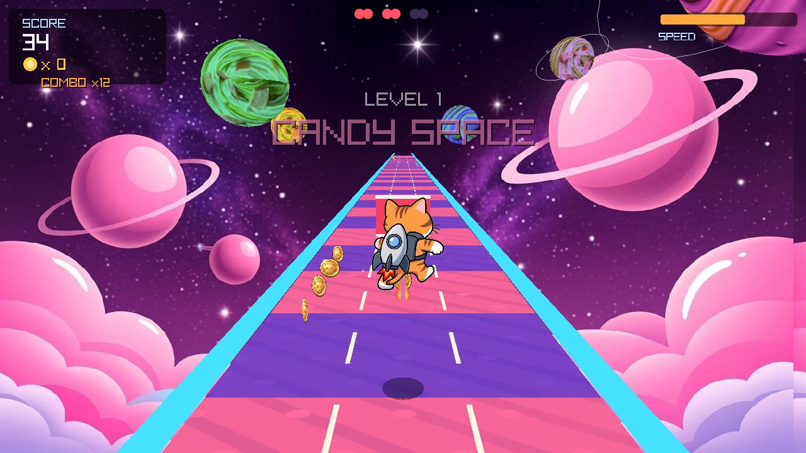
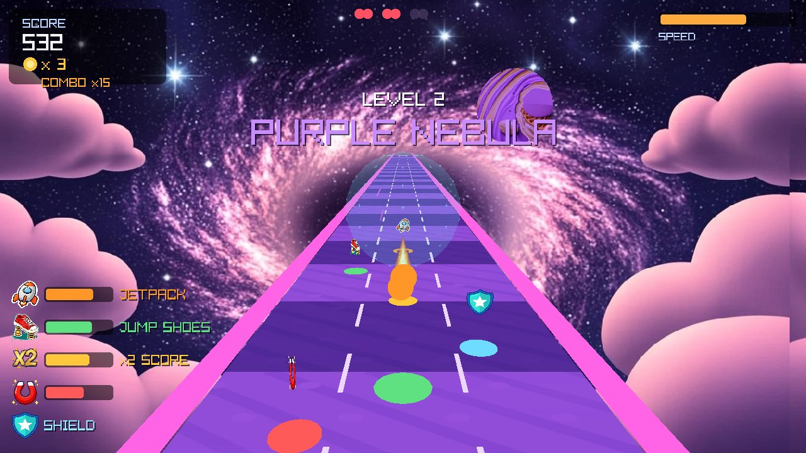
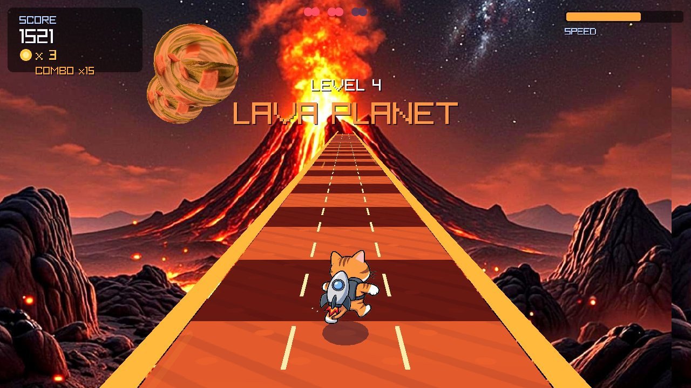
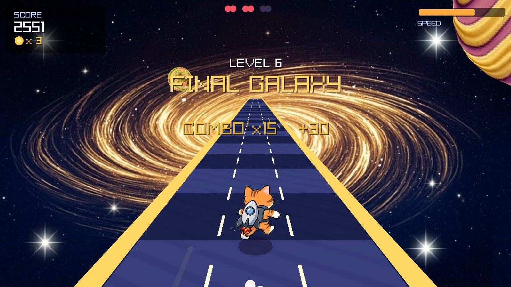
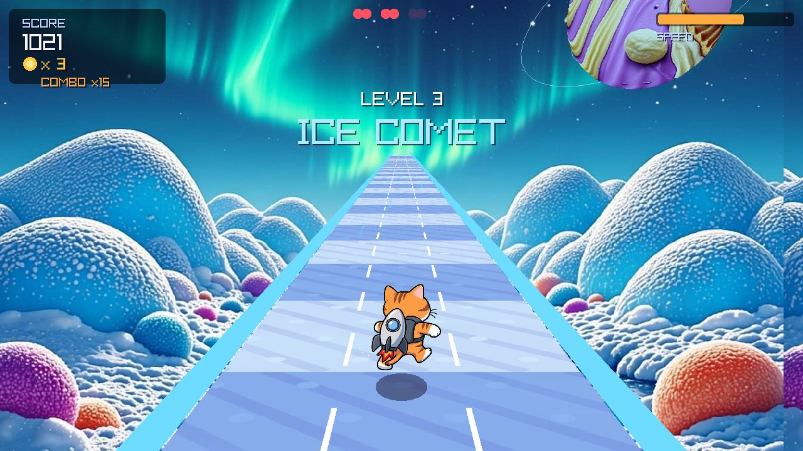
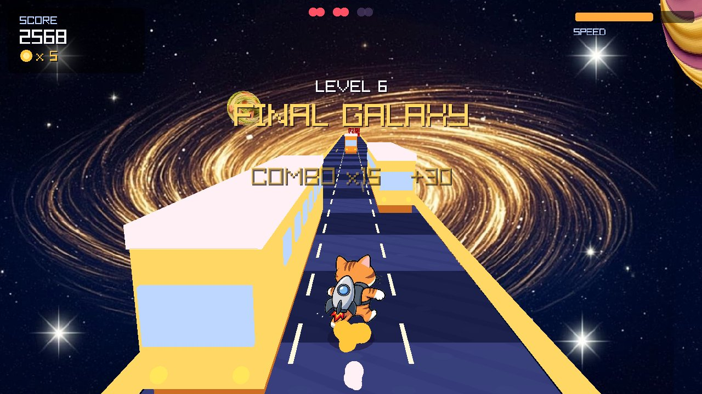
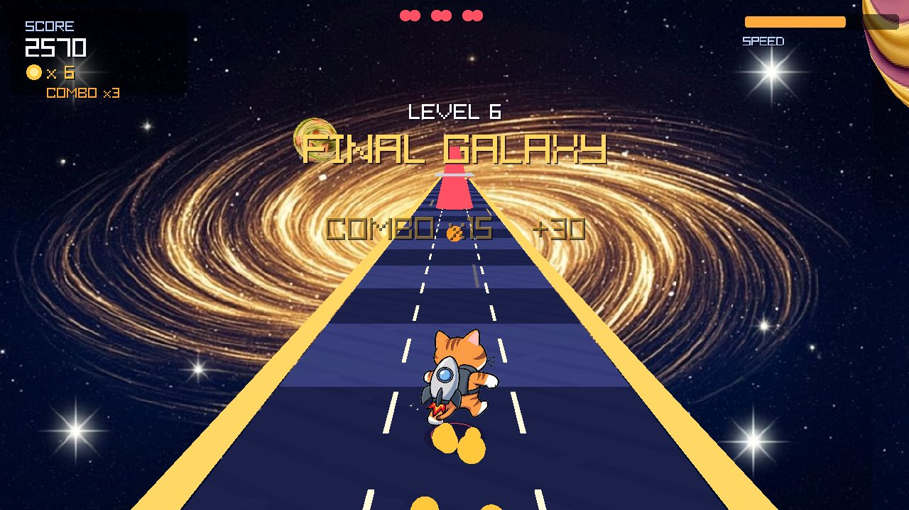
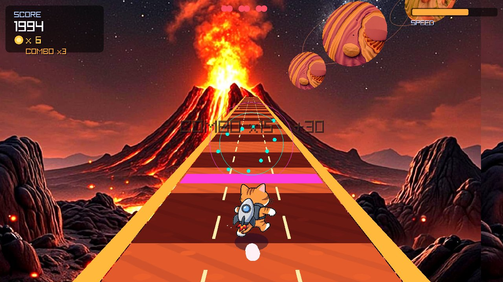
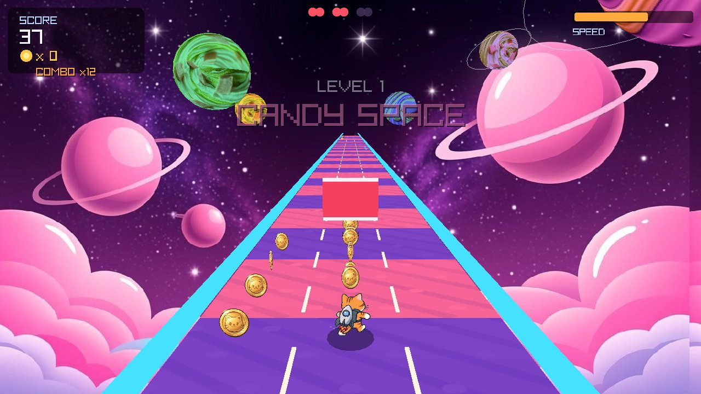
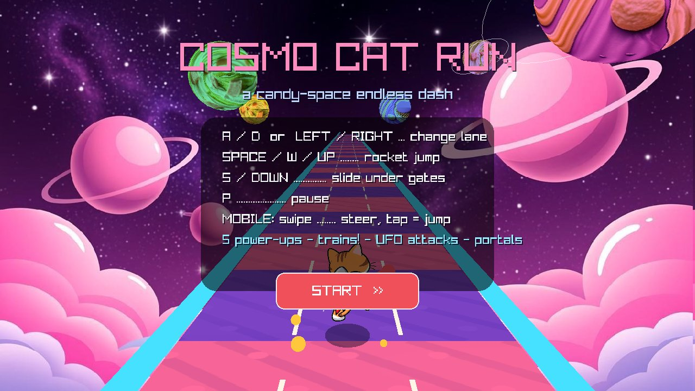

# 🚀 Cosmo Cat Run

A **2.5D endless runner**: a cartoon cat with a rocket backpack sprints down a
candy-coloured space highway. The cat really **runs** — bouncy gallop, faster
with speed, footstep dust — and only fires the rocket when jumping. It does a
little **celebration dance** in the menu and when you beat your best score.
Dodge the walls, rocket-jump over the hurdles, **slide under the gates**,
weave through the **subway trains**, dodge the **UFO's energy balls**, run
through the glowing **portals** into the next world, grab coins for
**combos**, survive on **3 hearts** — through **six level zones** (3 km loop)
that each bring their own backdrop, track colours and a chiptune loop that
**plays faster every level**. Touch friendly: **swipe to steer, tap to jump**
— built with a phone in one hand in mind. Like Subway Surfers, the run never
ends — it just keeps getting quicker.



The world is real 3D (built with [raylib](https://www.raylib.com)), the
gameplay is 2D (three lanes, jump) — that's the "2.5D" taste. The whole game
is one commented C++ file (`src/main.cpp`). The art (cat, coin, candy walls,
planets, space backdrop) is AI-generated and lives in `assets/`; if that
folder is ever missing, the game automatically falls back to shapes drawn
with code, so it runs anywhere no matter what.

---

## 🎮 How to play

| Input | Action |
| --- | --- |
| `A` / `D` or `←` / `→` | change lane |
| `SPACE` / `W` / `↑` | rocket jump |
| `S` / `↓` | slide (fits under overhead gates) |
| **Swipe** left / right / up / down | steer on touch screens (mouse-drag works too) |
| **Tap** | jump (touch screens) |
| `P` | pause |
| `ENTER` / `R` (after a crash) | retry |
| Mouse | click the START / RETRY buttons |
| `ESC` | quit |

Rules of the road:

- **Red walls** — change lane, you can't jump over them.
- **Green hurdles** — jump! There's a little arc of coins above them as a reward.
- **Red overhead gates** — slide under them (jumping won't fit!).
- **Subway trains** 🚇 — long cars parked across a lane (or racing straight at
  you, headlights first): too long and too tall — change lane!
- **UFO attacks** 🛸 — from level 2 on, a saucer swoops in, paints a red
  reticle on YOUR lane, fires an energy ball, then leaves. Change lane or
  jump over the ball!
- **Zone portals** 🌀 — a glowing ring appears before every 500 m boundary;
  run through it and the next world (banner, new colours, faster music) begins.
- **You have 3 hearts** ❤️ — a hit costs one heart and gives you a short
  blinking invincibility; lose them all and it's game over.
- **Coin combo** — keep grabbing coins within 2 s of each other; a chain of
  10+ pays a bonus (`COMBO x14 +28`!).
- The cat **runs, not floats**: bouncy gallop that gets faster with speed,
  footstep dust puffs, and the rocket fires only mid-jump.
- **Dance mode**: the cat sways, hops and sparkles on the menu — and throws a
  victory dance whenever you set a new best score.
- The highway speeds up the longer you survive, and **each new level zone
  bumps the speed up** — level 6 is more than twice as fast as the start.
- **Chiptune music** — a little code-sequenced loop (bass + arpeggio + hats)
  that plays **faster with every level zone**; sound effects (coin, jump,
  slide, crash, power-ups, combo fanfare) are synthesised in code too.
  No audio files needed.
- Nothing sits still: coins spin, planets drift, the cat bounces and leans,
  dust puffs on landing, and at top speed neon light-streaks whoosh past you.

The six level zones (the run loops through them forever — 3 km per lap):

| Zone | Look |
| --- | --- |
| **Level 1 — Candy Space** | pink & grape road, candy planets |
| **Level 2 — Purple Nebula** | violet road, magenta rails, glowing nebula |
| **Level 3 — Ice Comet** | pastel ice road, aurora sky |
| **Level 4 — Lava Planet** | ember rocks, volcano sky, golden rails |
| **Level 5 — Neon City** | synthwave skyline, magenta rails, cyan dashes |
| **Level 6 — Final Galaxy** | navy road, gold rails, a huge golden spiral galaxy |









Power-ups float above the road every so often — run through them:

- 🧲 **Magnet** (8 s) — nearby coins fly to you, even from other lanes.
- 🛡 **Shield** — a bubble around the cat; the next hit gets smashed instead
  of hurting you.
- ✖2 **Double** (10 s) — metres count twice AND every coin counts double.
- 👟 **Spring shoes** (8 s) — jumps 40% higher, with a boing and a green glow.
- 🚀 **Jetpack** (5 s) — the cat lifts off and flies above everything;
  obstacles, trains and UFO balls can't touch you until it sputters out.










Your best score is saved to `cosmocat_best.txt` next to the game.



---

## 📦 How to get your Windows .exe from GitHub (no coding needed)

GitHub Actions is set up as your personal robot: every time the code is
uploaded, GitHub builds `cosmo-cat-run.exe` for you. Follow these steps once:

### 1. Put the game on GitHub

1. Create a (free) account at [github.com](https://github.com), then click
   **New repository**. Name it `cosmo-cat-run`, set it to **Public**, and
   create it.
2. On the new repo page click **Add file → Upload files**.
3. Drag **everything inside this folder** into the browser window: the `src`,
   `assets`, `screenshots` and `.github` folders, plus `CMakeLists.txt`,
   `README.md` and `.gitignore`.
   - If dragging the `.github` folder doesn't work: click **Add file → Create
     new file**, type the name `.github/workflows/windows.yml`, paste the
     contents of that file from this folder, and commit.
4. Click **Commit changes**.

### 2. Let the robot build it

1. Open the **Actions** tab of your repo.
2. You'll see a run called **"Build Windows .exe"** — first build takes ~5
   minutes (it compiles raylib too). When it turns **green ✅**, you're done.

### 3. Download the .exe

Two options:

- **Just for you:** in the finished Actions run, scroll to the **Artifacts**
  section and download `cosmo-cat-run-windows` (a zip with the game).
  Unzip it anywhere and double-click `cosmo-cat-run.exe`. Requires being
  logged in to GitHub.
- **Shareable with everyone (recommended):** go to **Releases → Draft a new
  release**, type a tag name like `v1.0`, click **Create new tag**, then
  **Publish release**. The workflow attaches `cosmo-cat-run-windows.zip` to
  the release, and anyone can download it from your repo's Releases page —
  no GitHub login needed.

> 💡 **Windows SmartScreen note:** the .exe isn't code-signed, so Windows may
> show a blue warning on first run. Click **More info → Run anyway**. That's
> normal for small indie games.
>
> 💡 **Keep the `assets` folder next to the .exe** — it holds the game's art.
> If you move just the .exe without it, the game still runs but looks like
> plain shapes.

### 4. Every future update

Change code → upload the changed files → wait for the green check → publish a
new release with tag `v1.1`, `v1.2`, ... Same routine every time.

### 5. The Android .apk (experimental)

A second robot, `.github/workflows/build-apk.yml`, builds `cosmo-cat-run.apk`
the same way: it clones raylib, packs the game + assets into the gradle/NDK
project in the `android/` folder, and attaches the `.apk` to your Release
next to the .exe (and to the Actions artifacts). Install it on a phone by
opening the downloaded file and allowing "install from unknown sources".
It uses the same swipe/tap touch controls already built into the game.

> ⚠️ This one is **best-effort**: it could not be run-tested where the game
> was written (no Android NDK there). If the first run shows a red ❌, open
> the Actions log, copy the error, and tweak — usual suspects are the NDK /
> gradle version pins at the top of the workflow and in `android/app/build.gradle`.

### 6. Every future update

---

## 🛠 Build it yourself (optional)

If you'd rather compile locally, you only need **CMake** and a C++ compiler —
raylib is downloaded and built automatically.

**Windows** (with Visual Studio + CMake tools installed):

```bat
cmake -B build -DCMAKE_BUILD_TYPE=Release
cmake --build build --config Release
:: the game is at build\Release\cosmo-cat-run.exe
```

**Linux** (Debian/Ubuntu):

```bash
sudo apt install cmake build-essential libgl1-mesa-dev xorg-dev
cmake -B build -DCMAKE_BUILD_TYPE=Release
cmake --build build -j
# the game is at build/cosmo-cat-run
```

---

## 📁 Project structure

| File | What it is |
| --- | --- |
| `src/main.cpp` | the entire game (~1890 lines, commented section by section) |
| `assets/` | AI-generated art: cat, coin, wall & hurdle candy textures, planets, 6 zone backdrops, 5 power-up icons |
| `CMakeLists.txt` | build recipe — fetches and compiles raylib 5.5 automatically |
| `.github/workflows/windows.yml` | the GitHub Actions robot that builds the .exe |
| `.github/workflows/build-apk.yml` | the robot that builds the Android .apk |
| `android/` | the Android packaging project (gradle + NDK makefiles + manifest + NativeActivity glue) — the game code itself is still just `src/main.cpp` |
| `screenshots/` | the images used in this README |

---

## 🗺 Roadmap

- ~~v1.1 — sliding under gates, power-ups, more pattern variety~~ ✅ shipped
- ~~v1.2 — hearts, coin combos, per-level speed-up, code-synthesised sound
  effects~~ ✅ shipped
- ~~v1.3 — running cat, dance, 6 zones with new backdrops, chiptune music
  that speeds up per level~~ ✅ shipped
- ~~v1.4 — Subway-Surfers style: 5 power-ups (magnet, shield, x2 coins &
  score, spring shoes, jetpack), subway trains (incl. one racing at you),
  UFO saucer attacks, zone portals, swipe + tap touch controls~~ ✅ shipped
- **v1.5** — missions ("collect 50 coins in one run"), cat skins, local
  top-5 leaderboard, revive-with-coins.
- **v2.0** — Android .apk: the touch controls (swipe/tap) are shipped in the
  game, and the `android/` project + `build-apk.yml` workflow are in place to
  produce the `.apk`. The workflow still needs its first real run on GitHub
  (no NDK where the game was written) — if it goes red, fix the version pins
  and re-run.

Made with [raylib](https://www.raylib.com) 🐱
